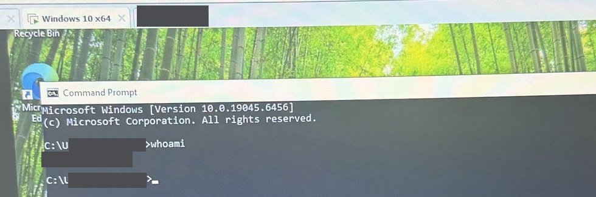

# Active Directory Domain Login Lab

I used VMware Workstation to practice signing in to a Windows 10 virtual machine with a test account from my Active Directory lab domain.

## Verification

1. Signed in to the Windows 10 VM with the domain test account.
2. Opened Command Prompt and ran `whoami`.
3. Confirmed that the output used the `DOMAIN\username` format and showed the expected lab domain.

The screenshot shows the verification command. I covered the domain, account name, and domain controller label before sharing it.
