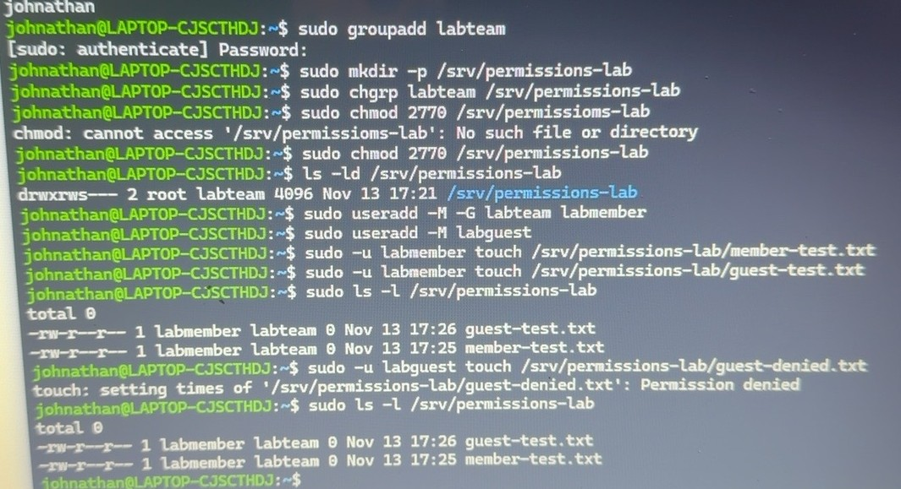

# Linux Permissions & Access Control on Ubuntu (WSL)

## Objective

Configure a shared Linux directory for a specific group, then verify that a member can create a file and a user outside the group is denied.

## Setup

```bash
sudo groupadd labteam
sudo mkdir -p /srv/permissions-lab
sudo chgrp labteam /srv/permissions-lab
sudo chmod 2770 /srv/permissions-lab
ls -ld /srv/permissions-lab
sudo useradd -M -G labteam labmember
sudo useradd -M labguest
```

The directory listing showed `drwxrws---` and ownership of `root:labteam`. Mode `2770` gives the owner and group full directory access. The setgid bit makes new files inherit the directory's group.

## Verification

| Test | Observed result |
|---|---|
| `sudo -u labmember touch /srv/permissions-lab/member-test.txt` | File created with owner `labmember` and group `labteam`. |
| `sudo -u labguest touch /srv/permissions-lab/guest-denied.txt` | `Permission denied`. The file was absent from the final listing. |

The evidence also shows `guest-test.txt`, created during an earlier test run as `labmember`. I reran the test as `labguest` with a fresh filename to verify access from outside the group.


