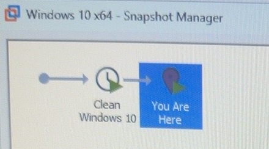
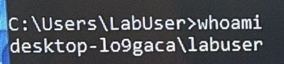

# Windows 10 VMware Lab

## Objective

Set up a Windows 10 virtual machine for desktop support practice, save a clean baseline, and verify access to a local Windows account.

## Lab steps

1. Installed Windows 10 x64 in VMware Workstation.
2. Saved a baseline snapshot named **Clean Windows 10** and confirmed it appeared in Snapshot Manager.
3. Signed in as the local **LabUser** account and ran `whoami` in Command Prompt to confirm which account was active.

## Evidence

### Baseline snapshot

### Local sign-in verification

